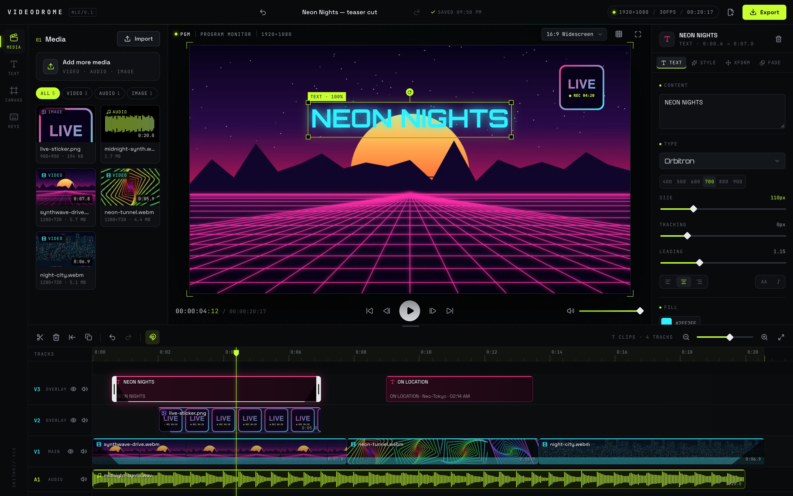
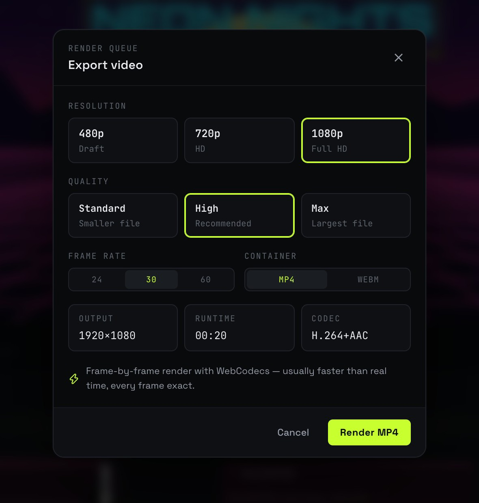

# VIDEODROME

A browser-based, non-linear video editor built from scratch with React, TypeScript, Canvas 2D, Web Audio and
WebCodecs. Dark, minimal, techno-styled UI with a Clipchamp-style layout. Everything runs on your machine —
there is no backend and nothing is uploaded.



<sub>Demo project in the screenshot: three generated clips (synthwave, neon tunnel, night city), a synth loop, a sticker overlay and two titles.</sub>

## Getting started

Requires [Node.js](https://nodejs.org) 20.19+ or 22.12+, and Chrome or Edge for the full feature set.

```bash
git clone https://github.com/drax0945/videodrome.git
cd videodrome
npm install
npm run dev        # open http://localhost:5173
```

`npm run build` type-checks and writes a static production build to `dist/`; `npm run preview` serves it.

## A tour of the interface

The layout follows the screenshot above, left to right and top to bottom.

### Top bar
- Editable **project name** with undo / redo either side and a live **autosave** indicator (`SAVED 09:50 PM`).
- Sequence status chip — resolution, frame rate and running time.
- **New project** and **Export**.

### Side rail and library panel
- **Media** — import video, audio and images with the button, by dropping files anywhere on the window, or by dropping straight onto the timeline. Each file gets a thumbnail or waveform, duration, resolution and size; filter by type, double-click or hit **+** to add, drag onto any track.
- **Text** — 10 ready-made title styles (headline, subtitle, lower third, neon, glitch, terminal typewriter, poster, outline, editorial, marker). Click to drop one at the playhead or drag it onto a track.
- **Canvas** — aspect ratio (16:9, 9:16, 1:1, 4:5, 21:9) and background colour.
- **Keys** — keyboard shortcut reference.

### Program monitor
- Live compositor of every track at the playhead, drawn on a canvas at the sequence resolution.
- Click an element to select it, then **drag to move**, pull a **corner to scale**, or use the **dot above it to rotate** — with snapping to the centre and frame edges (hold ⇧ to bypass). Double-click a title to edit its text.
- Aspect-ratio switcher, safe-area / rule-of-thirds guides, fullscreen.
- Transport: timecode (`HH:MM:SS:FF`), go to start / end, frame step, play / pause and monitor volume.

### Properties panel
Shows tabs for whatever is selected (with nothing selected it shows project stats):

| Tab | Applies to | What you can change |
| --- | --- | --- |
| **Text** | titles | content, font (37 families in a searchable picker, each previewed in its own typeface), weight (only the weights a font really has), size, tracking, leading, alignment, uppercase / italic, fill colour and opacity |
| **Style** | titles | animation (typewriter, slide, pop, glitch), background box, outline, glow |
| **Xform** | video, images, titles | position, scale, rotation, opacity, fit / fill frame |
| **Color** | video, images | one-click looks (Noir, Cyber, Vapor, Film, Vivid, Washed, Acid, X-Ray) plus brightness, contrast, saturation, hue, blur, mono, sepia, invert |
| **Audio** | video, audio | volume up to +6 dB, mute |
| **Speed** | video, audio | 0.1× – 4× (pitch follows speed, in preview and export) |
| **Fade** | everything | fade in / fade out for picture and sound |

### Timeline
- Unlimited **overlay and audio tracks** — higher tracks draw on top. Drop on the dashed zones above or below the tracks to create a new one; empty tracks tidy themselves away.
- Clips show **filmstrips**, **waveforms**, fade ramps, speed and mute badges.
- **Drag** to move (including between tracks), **drag either edge to trim**, **split** at the playhead, delete, **ripple delete**, duplicate.
- **Snapping** to the playhead and clip edges (hold ⌥ to bypass), with a magenta snap guide.
- **Zoom** with the slider, ⌘/ctrl + scroll, or **fit** to the whole sequence; per-track hide and mute; resizable timeline height.
- Full **undo / redo** for every edit.

### Export



- Renders **frame by frame with WebCodecs**: every output frame is drawn at its exact timestamp from exactly decoded source frames, and the audio is mixed offline — so exports are usually several times faster than real time, never drop frames, and keep going in a background tab.
- **MP4** (H.264 + AAC) or **WebM** (VP9 + Opus), at **480p / 720p / 1080p**, **24 / 30 / 60 fps** and three quality levels (constant-quality encoding where the browser supports it).
- Live preview of the frame being encoded, render speed, then an in-app player and **Download**.
- Browsers without WebCodecs fall back to a real-time `MediaRecorder` capture.

<br clear="right">

### Autosave
Every change is saved to the browser's IndexedDB — the timeline, settings, playhead **and the imported files
themselves** — so a reload or closed tab picks up exactly where you left off. **New project** clears it and starts
fresh. Undo history isn't kept across reloads, and projects stay in the browser they were made in.

## Keyboard shortcuts

| Action | Keys |
| --- | --- |
| Play / pause | Space |
| Split at playhead | S |
| Delete / ripple delete | ⌫ / ⇧⌫ |
| Duplicate | ⌘D |
| Undo / redo | ⌘Z / ⇧⌘Z |
| Step one frame / jump 1 s | ← → / ⇧← ⇧→ |
| Go to start / end | Home / End |
| Zoom timeline / fit | + − / ⇧Z |
| Nudge selected element | ⌥ + arrows |
| Deselect | Esc |

Ctrl replaces ⌘ on Windows and Linux.

## Fonts

Title fonts come from `@fontsource` packages and load on demand — only the font picker, or a title that uses a
font, downloads anything. To add one:

```bash
npm install @fontsource/<name>
```

Add it to the list in `scripts/gen-fonts.mjs`, then regenerate the catalog:

```bash
npm run fonts
```

## Architecture

```
src/
  state/      zustand store (tracks, clips, media, undo history), timeline maths, text presets,
              persist.ts – IndexedDB autosave / restore
  engine/     engine.ts  – clock, <video>/<audio> pool synced to the timeline, Web Audio mix, render loop
              render.ts  – canvas compositor (layout, filters, text + animations, hit-testing)
              media.ts   – import pipeline (metadata, thumbnails, waveform peaks)
              export.ts  – WebCodecs export: exact-timestamp decoding, per-frame render, offline audio mix,
                           muxing with Mediabunny
              export-realtime.ts – MediaRecorder fallback for browsers without WebCodecs
  fonts/      generated font catalog + per-family CSS bundles (lazy-loaded)
  components/ TopBar, SideRail, panels/, Preview (monitor + transform overlay + transport),
              Inspector, timeline/ (Timeline, ClipItem), ExportDialog, ui/ (controls, FontPicker)
```

**Browser support:** built for recent Chrome and Edge. Safari and Firefox load the editor, but canvas filters and
some export paths may be unavailable or fall back to slower modes.
